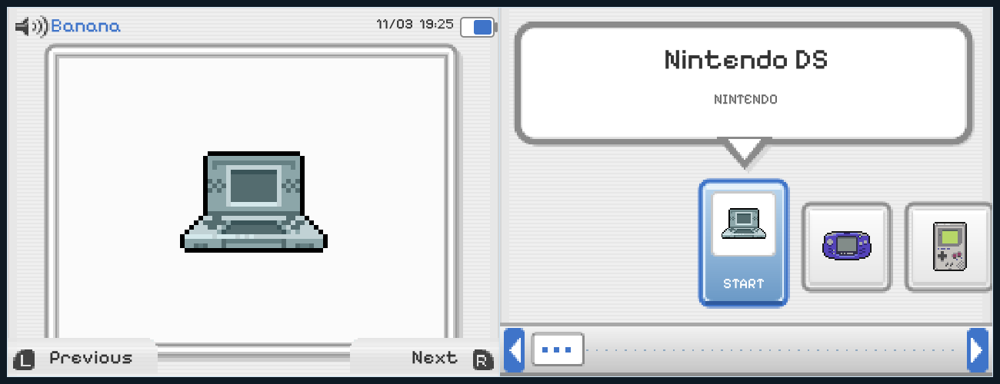
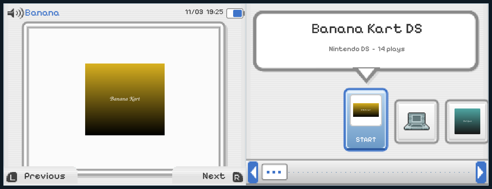
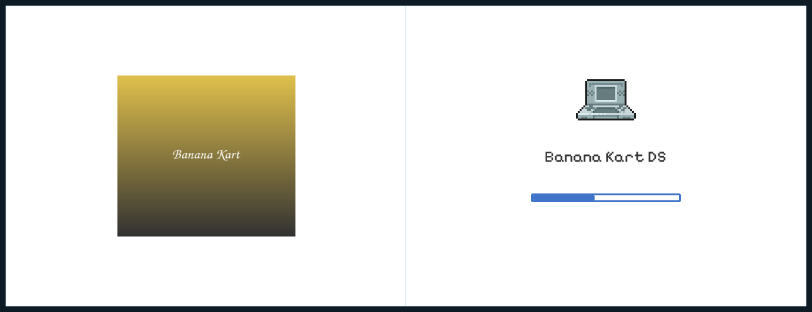

# BananaOS Themes

Layout themes for [BananaOS](https://github.com/JorreFog/BananaLinux), the custom firmware for the Anbernic
RG DS and RG DS Plus.

Each theme is one `.json`. The format is
[docs/THEMES.md](https://github.com/JorreFog/BananaLinux/blob/main/docs/THEMES.md); a theme that names pictures,
fonts or sounds keeps them in a folder beside its `.json`, named after the theme.

## Install

Copy a theme's `.json` (and its folder, if it has one) into `banana/themes/` on the card — over file sharing, or
with the card in a computer — then pick it in **Settings ▸ Display & sound ▸ Theme**.

---

## Retroism

A Windows 95 desktop in the [Chicago95](https://github.com/grassmunk/Chicago95) style: grey beveled windows with
square corners, navy title bars and selections, a taskbar along the top. Matches a niri + Quickshell "Retroism"
system. Everything but the wallpaper and the DOS VGA font is drawn from the file's own shapes and text — every
window carries the classic minimise, maximise and close boxes, and the tray shows the Wi-Fi signal, the battery
and the clock.

📄 [`retroism.json`](retroism.json) · 🖼️ [`retroism/wallpaper.png`](retroism/wallpaper.png)

The wallpaper is the author's own, downscaled to 1024×768 (the engine refuses a picture over 4096 px a side, and
the panels are only 640×480 and 1024×768); a light scrim sits over it so the icons and windows stay readable.

Home — the window on the top screen, the desktop with its system icons in a four-column grid on the bottom:

The game library — a game window on the top screen, the system's folder on the bottom:

Starting a game — a progress dialog over the desktop:

*(Every preview here is the theme rendered by BananaOS's own engine, so it shows exactly what the handheld
draws. Top screen on the left, bottom on the right.)*

---

## DSi Menu

The Nintendo DSi's white app menu, adapted to BananaOS's two screens. The top screen is the DSi's: the user name
in blue, the date, clock and battery, the box art in its white and silver frame, the L and R tabs along the bottom.
The bottom screen is the DSi's shelf: the white, silver-edged speech bubble with the title and maker, the row of
beveled app tiles (the selected one a blue gradient with **START**), and the silver page bar with its dotted line,
blue arrow buttons and page thumb. The art is drawn at the DSi's 256×192 ×4 (1024×768), so it is pixel-exact on the
RG DS Plus's panels (and nearest-scaled on the RG DS's 640×480); the frame, bubble, tiles and page bar are pixel art
with their bevels and shadows, and the text is BananaOS's pixel font on the same grid.

📄 [`dsi.json`](dsi.json) · 🖼️ [`dsi/bg-top.png`](dsi/bg-top.png) · 🖼️ [`dsi/pagebar.png`](dsi/pagebar.png)

Home — the selected system on the photo screen, the shelf on the bottom:

The game library — the box art in the frame, the games in the shelf:

Starting a game — the DSi's white launch, the box art growing away:

*(Every preview here is the theme rendered by BananaOS's own engine, so it shows exactly what the handheld
draws. Top screen on the left, bottom on the right.)*

---

## Make your own

The BananaOS checkout builds two editors: an offline web one (`tools/theme-studio/`) and a desktop one
(`tools/theme-studio-desktop/`, PySide6). Both read and write this format, so a theme made there drops straight
in. Start from any theme here, or from the examples that ship with BananaOS.

Fonts: BananaOS ships Pixelify Sans. A theme may name its own `.ttf` (relative to the `.json`) — keep in mind
some popular retro fonts are proprietary and can't be redistributed.

---

## Credits and license

**License: [GPL-3.0-or-later](LICENSE)** (the full text is in [`LICENSE`](LICENSE)).

- **Retroism**'s palette, window chrome and font come from
  **[Chicago95](https://github.com/grassmunk/Chicago95)** by Grassmunk and contributors (AdrianoML, EMH-Mark-I),
  licensed GPL-3.0+/MIT. Chicago95 recreates the Windows 95 look; this theme reuses its colours and geometry
  (face `#c0c0c0`, highlight `#ffffff`, shadow `#808080`, outline `#000000`, navy `#000080`, hover `#dfdfdf`)
  and its [`MorePerfectDOSVGA.ttf`](retroism/MorePerfectDOSVGA.ttf) font, and draws the screens with BananaOS's
  own elements. Thanks to its authors.
- The wallpaper in `retroism/` is the theme author's own.
- **DSi Menu**'s white pinstriped backgrounds, L and R tabs, volume icon and palette are from
  **[TWiLightMenu++](https://github.com/DS-Homebrew/TWiLightMenu)**'s "Default White" DSi skin by RocketRobz and
  DS-Homebrew ([`twlmenu-extras`](https://github.com/DS-Homebrew/twlmenu-extras), GPL-3.0), converted to 640×480
  PNGs at 4× the DSi's 256×192 (1024×768); the frame, title bubble, tiles, page bar and thumb are pixel art drawn to
  the same proportions (bevels, gradients and shadows included); the rest is BananaOS's own elements. TWiLightMenu++ recreates the
  Nintendo DSi Menu; Nintendo DSi, the DSi Menu design and its name are Nintendo's, this is a fan-made look-alike,
  and no firmware or ROM data is included.

---

## Support

If you'd like to support the project, you can buy me a coffee on Ko-fi:

**[https://ko-fi.com/jesussavesai](https://ko-fi.com/jesussavesai)**

And honestly -- paid or free, it all means a lot to me. A donation, a star, a bug report, or just using what I make: thank you. ❤️
